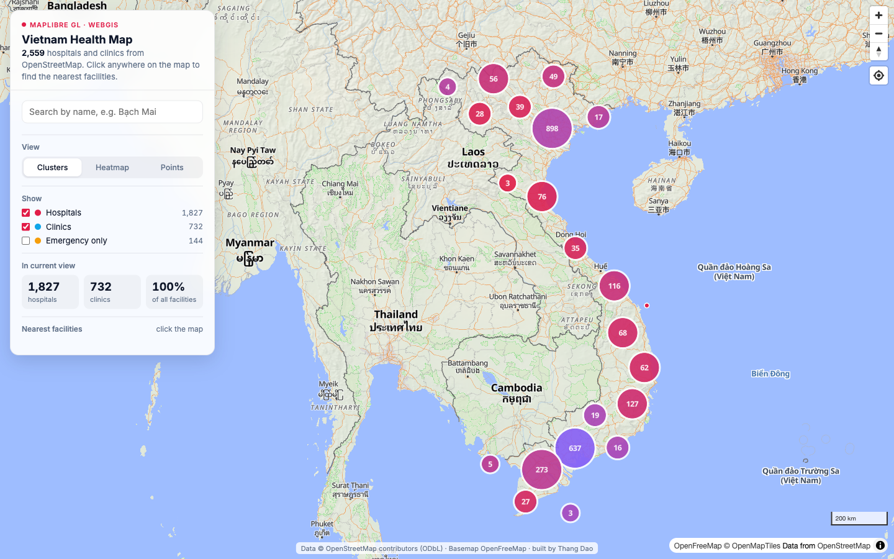
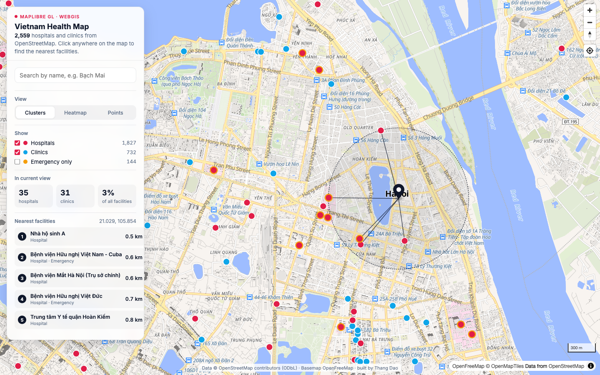
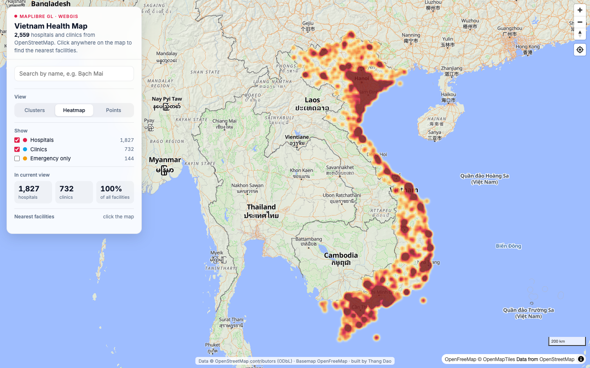

# Vietnam Health Map (MapLibre GL)

A WebGIS app covering about 2,500 hospitals and clinics in Vietnam, using open data from OpenStreetMap. It has clustering, a heatmap, filters, accent-insensitive search, and a tool that finds the nearest facilities.

**Live demo:** https://thanghps.github.io/vietnam-health-map/



| Nearest facilities (click anywhere) | Density heatmap |
|---|---|
|  |  |

## Features

- **Clustering.** Clusters are sized by count and colored by the share of hospitals versus clinics, using a `clusterProperties` aggregate. Clicking a cluster zooms to its expansion level.
- **Three views**, switchable at runtime: clusters, heatmap (weighted by facility type, with zoom-dependent radius and intensity) and raw points.
- **Filters**: hospitals, clinics, emergency-only. Every layer and the view statistics update together.
- **Live viewport statistics**: hospitals and clinics inside the current map bounds, recomputed on `moveend`.
- **Nearest-facility tool**: click anywhere to rank the 5 closest facilities by haversine distance. Each one gets a connecting line, and a dashed radius ring is drawn. The map fits to the result.
- **Vietnamese search** that ignores diacritics: "bach mai" finds "Bạch Mai".
- **Popups** with address, phone, number of beds, specialities and an emergency tag when OSM has them.
- **Correct regional labelling**: Biển Đông and Vietnam's archipelagos (Hoàng Sa, Trường Sa) are labelled explicitly.
- Responsive bottom-sheet layout on phones. Geolocate, scale and navigation controls.

## Data

`data/facilities.geojson` is a compact extract of `amenity=hospital` and `amenity=clinic` inside Vietnam, pulled from the Overpass API on 2026-10-31. It contains 2,559 features (about 470 KB). Data © OpenStreetMap contributors, ODbL. The basemap is OpenFreeMap, which needs no API key.

## Run locally

```bash
python3 -m http.server 8000
# open http://localhost:8000
```

There is no build step. MapLibre GL JS 4.7 loads from unpkg.

Deep links: `?view=heat`, `?near=21.0285,105.8542`, `?q=bach mai`

---

Built by **Thang Dao**, a WebGIS / CesiumJS / Three.js developer.
